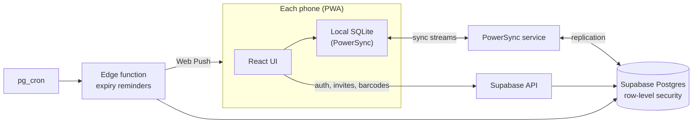

# Namliyeh (النملية)

**A household app for supplies and money, shared by a family on Android and iPhone, in Arabic and English, and fully usable offline.**

**Live app:** <https://namliyeh.pages.dev> · **Stack:** React, TypeScript, Supabase (Postgres), PowerSync · **Status:** live, in daily use by my household

The name comes from the *namliyeh*, the old Palestinian kitchen cupboard with a mesh door that kept food fresh and safe. The app does the same job for a modern home: it knows what is in the house, what is about to expire, what needs buying, and where the money went.

---

## Contents

- [Why it exists](#why-it-exists)
- [Features](#features)
- [Architecture](#architecture)
- [Key engineering decisions](#key-engineering-decisions)
- [Security and privacy](#security-and-privacy)
- [Arabic, English and right-to-left](#arabic-english-and-right-to-left)
- [Testing](#testing)
- [Project structure](#project-structure)
- [Getting started](#getting-started)
- [Deployment](#deployment)
- [Roadmap](#roadmap)
- [Contact](#contact)

## Why it exists

A family needs one shared answer to three questions: *what do we have, what do we need, and what did we spend?* Most apps answer them for one person, need a connection, and speak English first. Namliyeh is built for a real household instead: an 8-year-old and a 99-year-old must be able to manage the daily tasks alone, on whatever phone is in the house, with or without internet.

That goal sets the rules for every screen: three big buttons for the daily tasks, tap before type, a picture beside every item, text that follows the phone's text size, and an **Undo on every action**.

## Features

| Area | What it does |
| --- | --- |
| **We bought** | Record a shopping trip in a few taps. Stock goes up, expiry dates are set, and one expense is logged. |
| **We used** | One tap per item finished or thrown away. The earliest-expiring batch is used first. Undo on every action. |
| **To buy** | Items below their minimum, items running low, and anything added by hand. "We bought these" takes the whole list. |
| **Use soon** | What expires in the next few days, with phone notifications as a reminder. |
| **Barcode scanning** | Scan a product to add or use it. Shared barcode memory across homes, name suggestions from Open Food Facts, works offline on Android and iPhone. |
| **Money** | Income and expenses typed in by hand, in shekel, dinar, dollar or euro, with monthly totals by category and person. No bank or card data, ever. |
| **Families** | One home per family, joined with an invite code. Several phones stay in sync. |
| **Install** | A PWA: installs from the browser on Android and iPhone, no app store. Install help is built in, including for in-app browsers. |

## Architecture



| Layer | Choice |
| --- | --- |
| App | React 19, Vite and TypeScript, installed as a PWA |
| Local data | SQLite on each phone through PowerSync, so every screen reads local data |
| Database | Postgres on Supabase with row-level security per household |
| Sync | PowerSync sync streams (`powersync/sync-config.yaml`) |
| Push | Web Push from a Supabase edge function, scheduled with `pg_cron` |
| Hosting | Cloudflare Pages, deployed on every push to `main` |
| Tests | Vitest for app logic, an in-process Postgres (PGlite) for the real migrations |

## Key engineering decisions

- **Offline first, not offline tolerant.** All calculations (stock, shopping list, expiry, money totals) are SQL on the phone, so they work with no connection and on a slow one. See `src/data/queries.ts`.
- **One write path.** Every write goes through one file and one local transaction (`src/data/actions.ts`), which keeps behaviour, Undo and sync consistent.
- **Stock is a log, not a number.** Quantity is the sum of a movement log. Two phones that change the same item while offline never overwrite each other; both movements merge when they sync.
- **Shared catalog, private households.** Prices and barcodes are shared across homes without any household, user or quantity attached. Everything else belongs to one household.
- **Money in the smallest unit.** Amounts are stored in agorot, fils or cents with the original currency and rate kept per entry, so totals are exact and history stays correct when rates change.
- **Migrations are the source of truth.** The schema, access rules, starter catalog, keep-alive, push reminders and barcode lookup all live in `supabase/migrations`, and the test suite runs those same files.
- **Free plans, kept alive.** Daily GitHub Actions jobs keep the free Supabase and PowerSync instances from pausing.

## Security and privacy

- Row-level security on every table; a household can only read and write its own rows.
- Migrations start from `revoke all` and grant the minimum back, rather than relying on defaults.
- Server secrets (the push keys and the cron secret) are generated on the server, stored in a private schema the API cannot reach, and never leave it.
- The client holds only the publishable key. The service-role key is never used in the app or in CI.
- No bank or card data is stored. The only barcode data sent to a third party is the number, to Open Food Facts, to suggest a name.
- Privacy policy and terms are included in the app (`public/privacy.html`, `public/terms.html`).

## Arabic, English and right-to-left

The app is Arabic-first. Every text exists in both languages, with formal Arabic and right-to-left layout from the first screen, numbers in the reader's own digits, and self-hosted Arabic fonts that work offline. A test fails the build if any string is missing in either language.

The design language (colours, shapes, the wire-mesh motif, type and icons) is documented in [docs/DESIGN.md](docs/DESIGN.md).

## Testing

```bash
npm test
```

- **`tests/db`** runs the real migrations in an in-process Postgres and checks privacy between households, invites and price sharing.
- **`tests/app`** runs the real actions and SQL against SQLite: buying, using the earliest-expiring batch first, undo, corrections, the shopping list, expiry, currencies, monthly reports, barcodes, install detection, and that every text exists in both languages.

## Project structure

```
src/
  app/        shell, routing, session, household, install, push
  data/       schema, queries, actions, sync connector, money, dates, barcodes
  screens/    Home, Buy, Use, Need, Stock, Money, Settings, Auth, Onboarding
  ui/         shared components (Sheet, Scanner, Stepper, ItemPicker, icons)
  i18n/       Arabic and English texts
supabase/
  migrations/ schema, access rules, catalog, keep-alive, push, barcode lookup
  functions/  expiry-reminders edge function
powersync/    sync streams
tests/        app (SQLite) and db (Postgres) suites
docs/         design language
.github/      daily keep-alive workflows
```

## Getting started

Requires Node 22 or later and free accounts on Supabase, PowerSync and Cloudflare. The one-time setup (about 30 minutes, no card needed) is in **[SETUP.md](SETUP.md)**.

```bash
git clone https://github.com/TariqSharia/namliyeh.git
cd namliyeh
cp .env.example .env.local   # fill in your Supabase and PowerSync values
npm install
npm run dev                  # http://localhost:5173
```

| Script | Purpose |
| --- | --- |
| `npm run dev` | Start the development server |
| `npm run build` | Type-check and build for production |
| `npm run typecheck` | TypeScript only |
| `npm test` | App and database tests |

## Deployment

Cloudflare Pages builds `npm run build` and serves `dist`. Every push to `main` publishes a new version, and phones update the next time the app opens. Database changes are applied as migrations from `supabase/migrations`.

## Roadmap

- [x] Data model, migrations and access rules
- [x] Buy, use, shopping list, expiring soon, corrections, labels
- [x] Income and expenses with monthly reports
- [x] Arabic and English, right to left
- [x] Offline with sync
- [x] Google sign-in, install help for Android, iPhone and in-app browsers
- [x] Daily keep-alive for the free plans
- [x] Expiry reminders as phone notifications
- [x] Barcode scanning with shared barcodes
- [ ] Recurring entries and budgets
- [ ] Price comparison between shops
- [ ] Catalog review screen

## Contact

Built by **Tariq Sharia**, software developer, Ramallah, Palestine.
Email: [t.sharia2000@gmail.com](mailto:t.sharia2000@gmail.com) · GitHub: [@TariqSharia](https://github.com/TariqSharia)